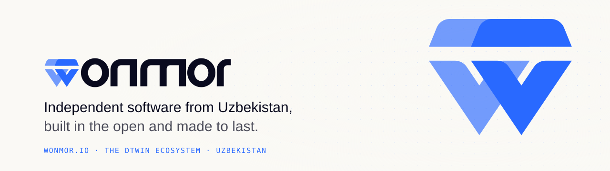

<a href="https://wonmor.io">
  <picture>
    <source media="(prefers-color-scheme: dark)" srcset="banner-dark.svg">
    
  </picture>
</a>

  
  
  
  

Wonmor is a self-funded brand from Uzbekistan that builds and supports the **dtwin ecosystem**: a personal planner anchored to the five daily prayers, an open-source Uzbek keyboard, and the tools and infrastructure around them. It is not a company: there is no legal entity, no board and no investors. One founder builds the products, working with AI agents, and every change goes through a pull request, continuous integration and a human merge.

## Repositories

The product code lives in **[github.com/dtwinuz](https://github.com/dtwinuz)**. This organization holds the Wonmor site and the shared, open material around it.

| Repository | What it holds | Licence |
|---|---|---|
| [wonmor.io](https://github.com/wonmortech/wonmor.io) | Source of [wonmor.io](https://wonmor.io) in English, Uzbek and Russian: Astro, deployed by GitHub Actions on every merge | — |
| [research](https://github.com/wonmortech/research) | Reproducible material behind the posts on [wonmor.io/research](https://wonmor.io/research/) | MIT |
| [uz-open-data](https://github.com/wonmortech/uz-open-data) | Open data for Uzbekistan: mosques from OpenStreetMap, the Uzbek Cyrillic to Latin table | MIT |
| [deploy-kit](https://github.com/wonmortech/deploy-kit) | Zero-downtime static site deploys: releases, symlink swap, Caddy reload, rollback | MIT |
| [design-system](https://github.com/wonmortech/design-system) | Wonmor design tokens (`@wonmor/tokens`): colour, type, spacing, motion | MIT |
| [brand](https://github.com/wonmortech/brand) | The Wonmor mark, lockups, colours, brand film and the rules for using them | See repo |
| [open-source-fund](https://github.com/wonmortech/open-source-fund) | The planned Wonmor Open Source Fund. Not accepting applications yet. | See repo |
| [.github](https://github.com/wonmortech/.github) | This profile, contributing guide, code of conduct and security policy | — |

## Products

Products with a public address. Release levels are explained on [wonmor.io/responsible-release-policy](https://wonmor.io/responsible-release-policy/).

| Product | What it is | Status | Links |
|---|---|---|---|
| dtwin | A personal life planner whose day is anchored to the five daily prayers | Beta | [dtwin.uz](https://dtwin.uz) |
| bitg | An open-source Uzbek keyboard that converts text to the 2026 Latin alphabet as you type, on Windows, Linux and macOS | Beta | [bitg.uz](https://bitg.uz) · [source](https://github.com/dtwinuz/bitg) |
| TeleTwin | A company layer for Telegram: work chats and channels kept apart from personal ones | MVP | [tele.dtwin.uz](https://tele.dtwin.uz) · [source](https://github.com/dtwinuz/teletwin-web) |
| Gateway | One control point between AI agents and the systems they are allowed to use | MVP | [gateway.dtwin.uz](https://gateway.dtwin.uz) |
| Tunnel | Publishes a service running on your own machine at a public address, on infrastructure we run ourselves | MVP | [tunnel.dtwin.uz](https://tunnel.dtwin.uz) |
| Fam | A self-hosted bug-capture tool: one link carries the video, logs and context of a problem | Preview | [fam.dtwin.uz](https://fam.dtwin.uz) |
| operobot | An outbound calling assistant designed around Uzbekistan's rules for advertising calls | Prototype | [operobot2.dtwin.uz](https://operobot2.dtwin.uz) · [source](https://github.com/dtwinuz/operobot2) |
| shop | An experiment: a catalogue for small clothing stores | Experiment | [shop.dtwin.uz](https://shop.dtwin.uz) |
| gym | An experiment: an open-source workout diary | Experiment | [gym.dtwin.uz](https://gym.dtwin.uz) · [source](https://github.com/dtwinuz/gym-dtwin) |
| med | An experiment: a study platform for medicine | Experiment | [med.dtwin.uz](https://med.dtwin.uz) |

Every product has its own page at [wonmor.io/products](https://wonmor.io/products/).

## How we work

- **Every change is a pull request.** CI builds and checks it; merges are squash-only, into a protected `main`.
- **Security by default.** Secret scanning with push protection, Dependabot, CodeQL and private vulnerability reporting are on for every repository.
- **Facts with sources.** Every number and claim on wonmor.io links to where it comes from. Planned work is labelled as planned.

## Read more

- [Charter](https://wonmor.io/charter/): seven principles that decide how we build, release and look after the products
- [Research](https://wonmor.io/research/) and [Engineering](https://wonmor.io/engineering/): what we are working on and how to reproduce it
- [Changelog](https://wonmor.io/changelog/): every release across the ecosystem, also as [RSS](https://wonmor.io/changelog.xml)
- [Open source](https://wonmor.io/open-source/): which repositories are public, under which licences, and how to contribute
- [Security](https://wonmor.io/security/): how to report a vulnerability privately

## Contact

Telegram: [t.me/xnosir](https://t.me/xnosir). Bugs and ideas go to an issue in the repository they belong to; questions go to [Discussions](https://github.com/wonmortech/.github/discussions). Please do not report vulnerabilities in public issues; see the [security policy](https://wonmor.io/security/).
